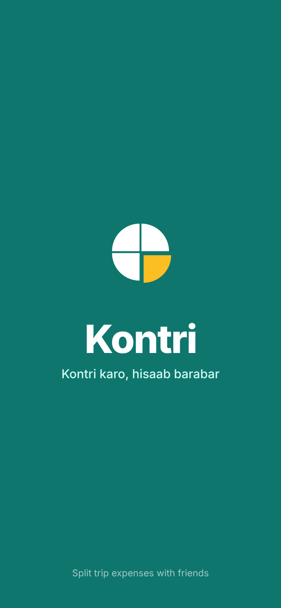
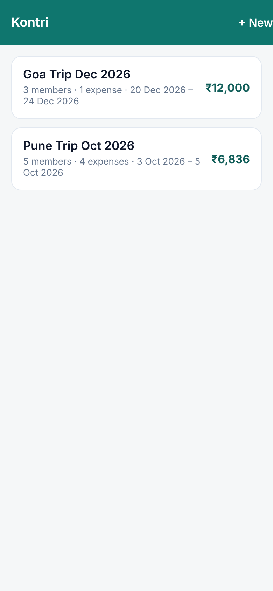
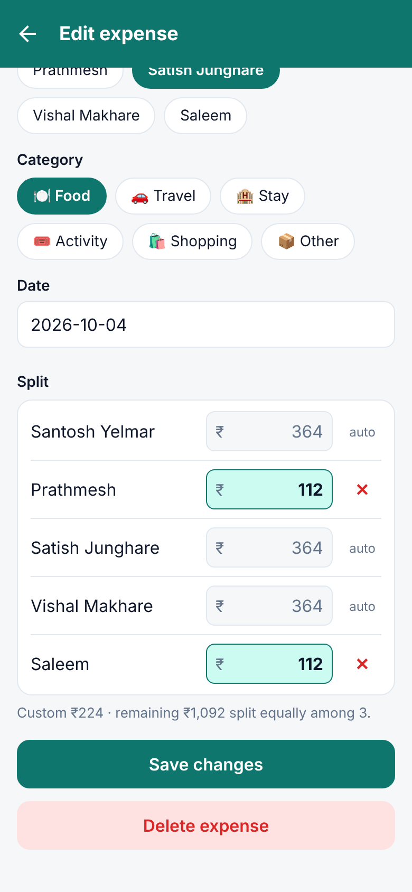
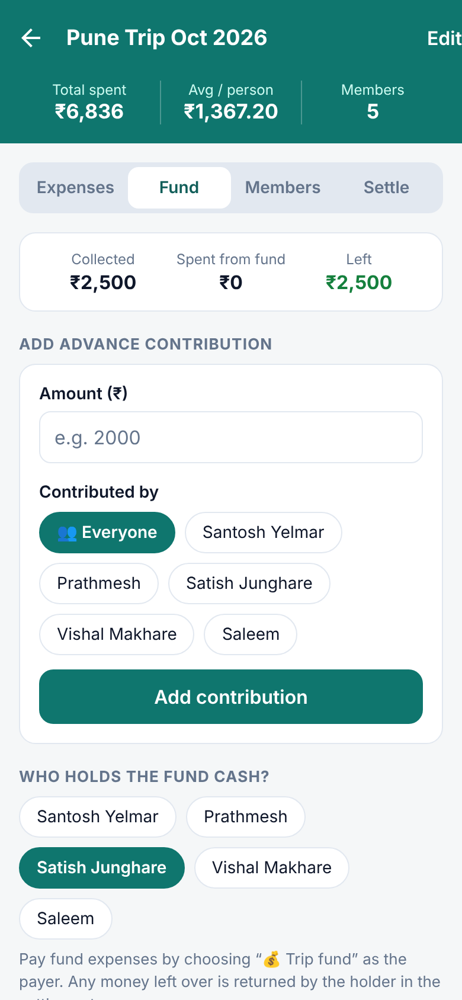
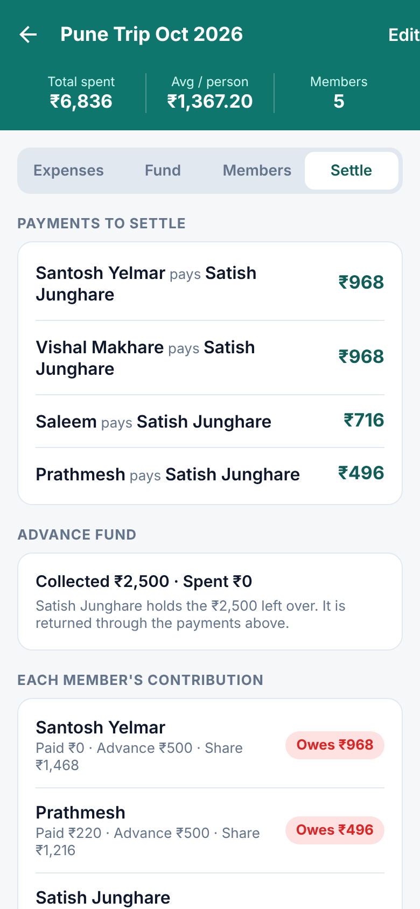
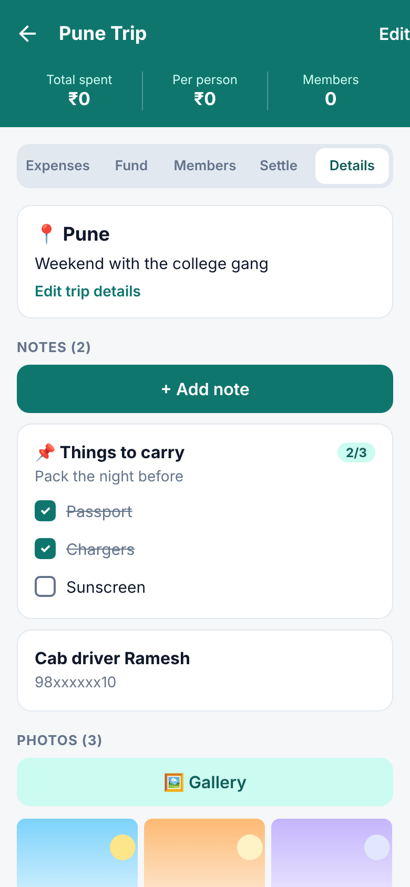

<div align="center">


# Kontri

**Kontri karo, hisaab barabar.**

Split trip expenses with friends: record who paid, collect an advance kitty,
adjust shares per expense, and settle up with the fewest payments.

[](https://github.com/satishjunghare/kontri/actions/workflows/android-apk.yml)
[](https://github.com/satishjunghare/kontri/releases/download/tripsplit-latest/Kontri.apk)


[](LICENSE)

</div>

---

## Why Kontri?

On every trip with friends, someone pays for the hotel, someone for fuel, someone for dinner,
and sometimes everyone puts money into a kitty in advance. At the end, working out
*"who owes whom, and how much?"* takes a calculator, a WhatsApp argument and a lot of patience.

**Kontri does the hisaab for you.** Add the trip, your friends and the expenses. Kontri
tells everyone their fair share and the exact payments needed to settle, then sends it to
your WhatsApp group as a clean bill.

> *Kontri* is how friends across India talk about pooling money: "chal, kontri karte hain".

## Screenshots

| Splash | Trips | Add expense | Advance fund | Settle up | Notes & photos |
|:--:|:--:|:--:|:--:|:--:|:--:|
|  |  |  |  |  |  |

<sub>Screenshots use a sample trip: Pune, 5 friends, ₹500 advance each, and a custom-split dinner.</sub>

## Features

| | Feature | What it does |
|:--:|---|---|
| 🧳 | **Trips** | Create trips with a name, currency (₹, $, €, £, AED, ฿), optional dates, destination and description |
| 👥 | **Members** | Add friends to a trip; duplicate names are blocked |
| 🧾 | **Expenses** | Amount, description, who paid, category (food, travel, stay, activity, shopping) and date |
| ⚖️ | **Custom split** | Split equally by default, or fix an amount for some members (₹0 = not included); the rest is split equally among the others, live as you type |
| 💰 | **Advance fund (kitty)** | Record money collected in advance ("everyone gives ₹2,000"), choose who holds the cash, and pay expenses from the fund; leftover cash is returned in the settlement |
| ✅ | **Settle up** | Each member's share, who owes and who gets back, and the **fewest payments** needed to settle |
| 📲 | **WhatsApp bill** | Share the settlement as a receipt-style bill: expenses, totals, shares and amounts due, grouped by who receives the money |
| 📝 | **Notes & checklists** | As many notes as you like per trip (booking details, phone numbers, packing list), with checklists you tick off and an option to pin important notes |
| 📷 | **Photos** | Take photos or pick from your gallery, add captions, view full screen, and choose a cover photo that shows on the trips list. Photos are shrunk and stay on your phone |
| 📴 | **Offline & private** | Everything stays on your phone. No login, no internet needed, no data sent anywhere |

## How it works

**Example: Goa trip, 4 friends**

| Expense | Paid by | Split |
|---|---|---|
| Hotel ₹6,000 | Satish | Equal: ₹1,500 each |
| Dinner ₹2,000 | Rahul | Amit ₹200 (custom), others ₹600 each |

| Member | Paid | Share | Result |
|---|--:|--:|---|
| Satish | 6,000 | 2,100 | **gets back ₹3,900** |
| Rahul | 2,000 | 2,100 | owes ₹100 |
| Amit | 0 | 1,700 | owes ₹1,700 |
| Priya | 0 | 2,100 | owes ₹2,100 |

**Payments to settle:** Priya → Satish ₹2,100 · Amit → Satish ₹1,700 · Rahul → Satish ₹100

### The rules, in short

- **Shares:** each expense is split equally, except members with a custom amount, who pay
  exactly that; the remainder is split equally among the rest.
- **Advance fund:** an advance counts as money that member paid. Cash left in the fund is with
  the holder, so it is counted against them and returned through the settlement.
- **Balance** = paid + advance − fund cash held − share.
- **Fewest payments:** the person who owes the most pays the person owed the most, repeated
  until everyone is settled.
- **Exact to the paisa:** amounts are stored as whole paise, and leftover paise from uneven
  splits (e.g. ₹100 ÷ 3) are handed out so totals always match exactly.

## Sample WhatsApp bill

```
       PUNE TRIP OCT 2026
           FINAL BILL
--------------------------------
EXPENSES                       ₹
Hotel (Satish)             3,500
Fuel (Satish)              1,800
Dinner* (Satish)           1,316
Tea & snacks (Prathmesh)     220
--------------------------------
TOTAL SPENT                6,836
Advance collected          2,500
  (unused, held by Satish)
Friends                        5
--------------------------------
SHARE PER PERSON               ₹
Santosh Yelmar             1,468
Prathmesh                  1,216
Satish Junghare            1,468
Vishal Makhare             1,468
Saleem                     1,216
* Dinner custom split:
  Prathmesh, Saleem 112 each
  Others 364 each
--------------------------------
AMOUNT DUE -> Satish Junghare
Santosh Yelmar               968
Vishal Makhare               968
Saleem                       716
Prathmesh                    496
--------------------------------
SATISH RECEIVES            3,148
--------------------------------
       Shared via Kontri
```

## Download & install (Android)

1. On your Android phone, download **[Kontri.apk](https://github.com/satishjunghare/kontri/releases/download/tripsplit-latest/Kontri.apk)** (about 12 MB).
2. Open the file. If asked, allow **"Install unknown apps"** for your browser.
3. Tap **Install** (or **Update**; your saved trips are kept).

> **Older phone?** If it says *"App not installed"*, your phone runs 32-bit Android.
> Use the APK from the **"Kontri for older phones"** release instead.

## Tech stack

| Area | Technology |
|---|---|
| App | [React Native](https://reactnative.dev) 0.88 + [Expo](https://expo.dev) SDK 58, TypeScript |
| Navigation | React Navigation (native stack) |
| Storage | AsyncStorage for trips, the app's own folder for photos; on the device only |
| Logic | Pure TypeScript modules, unit tested with `node:test` |
| Quality | TypeScript strict mode, ESLint (`eslint-config-expo`) |
| Build | GitHub Actions: tests → Expo prebuild → Gradle release APK → GitHub Release |

## Project structure

```
App.tsx                       Navigation, providers, splash hand-over
src/
├── components/
│   ├── AppSplash.tsx         Animated "Sab milke" splash screen
│   └── ui.tsx                Buttons, cards, inputs, chips, dialogs
├── lib/                      Pure logic (unit tested)
│   ├── settlement.ts         Balances, fund handling, fewest-payments algorithm
│   ├── split.ts              Equal and custom per-expense splits
│   ├── notes.ts              Note sorting and checklist helpers
│   ├── photos.ts             Photo shrinking and on-device storage
│   ├── shareText.ts          WhatsApp bill generator
│   └── money.ts              Paise parsing and ₹ formatting (Indian digit grouping)
├── screens/
│   ├── TripsListScreen.tsx   All trips
│   ├── TripFormScreen.tsx    Create / edit trip
│   ├── TripDetailScreen.tsx  Trip summary + tabs
│   ├── NoteFormScreen.tsx    Add / edit a note and its checklist
│   ├── PhotoViewerScreen.tsx Full-screen photo, caption, cover, delete
│   ├── ExpenseFormScreen.tsx Add / edit expense with split
│   └── trip/                 Expenses, Fund, Members, Settle and Details tabs
├── store/TripsContext.tsx    App state + on-device persistence
└── theme.ts                  Colours and category labels
assets/                       App icon, adaptive icon, splash slices
.github/workflows/            Android APK build
```

## Development

**Requirements:** Node.js 22+

```bash
npm install          # install dependencies
npm start            # Expo dev server (Android, iOS, web)
npm test             # unit tests for settlement, splits, money and the bill
npm run typecheck    # TypeScript
npm run lint         # ESLint
```

### Building the APK

Every push to the main branch builds `Kontri.apk` with GitHub Actions and publishes it to the
**"Kontri (latest build)"** release. To also build the APK for older 32-bit phones, open
**Actions → Android APK → Run workflow** and tick **"older phones"**.

APKs are built for one CPU architecture each, with code and resource shrinking, to keep them
small (about 12 MB). They are signed with a debug key, which is fine for personal use.

## Roadmap

- [ ] Mark payments as **paid ✓** after the trip
- [ ] Share a trip with friends so everyone can add expenses (sync)
- [ ] UPI pay links in the WhatsApp bill
- [ ] Receipt photos for expenses
- [ ] Backup and restore a trip (including photos)
- [ ] Date picker
- [ ] Marathi / Hindi language

## Privacy

Kontri has no account, no server and no analytics. Your trips, notes and photos are stored only on
your phone, and nothing is sent anywhere unless you choose to share a bill. The camera and photo
access are used only when you add a photo to a trip.

## License

Released under the [MIT License](LICENSE). You can use, change and share the code, as long as
the copyright notice is kept.

## Author

Built by **[Satish Junghare](https://github.com/satishjunghare)**, for trips with friends.
